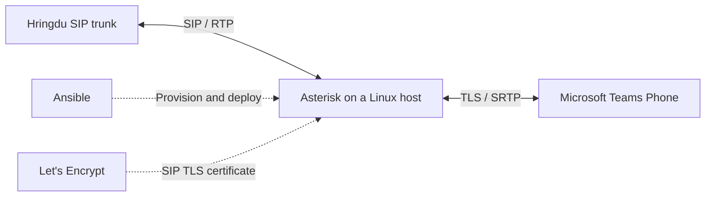

# Hringbrú

[](https://github.com/depill/hringbru/actions/workflows/image.yml)

**A small, reproducible SIP bridge between an existing Hringdu trunk and Microsoft Teams Phone.**

Hringbrú packages Asterisk in Docker and uses Ansible to provision and deploy it to a Linux server. It is intended to carry incoming calls from the carrier into Teams and outgoing calls from Teams back through the carrier, with Let's Encrypt certificates securing the Teams SIP connection.

The repository and command-line identifiers use `hringbru`. Existing installations under the former name Sipsip can [retain their deployment identifiers and data](docs/operations.md#existing-sipsip-installations).

**Status: experimental.** Local tests pass, and live testing has confirmed Hringdu registration, Teams SIP OPTIONS in both directions, and outbound call setup through to carrier ringing. Answered calls, two-way audio and the remaining [acceptance checks](docs/acceptance.md) still require validation. Asterisk is **not a Microsoft-certified SBC**, so this direct interconnect is outside Microsoft's supported Direct Routing configuration. A supported production deployment requires a [certified SBC](https://learn.microsoft.com/en-us/microsoftteams/direct-routing-plan).

## Why this exists

[Hringdu](https://www.hringdu.is/) is an Icelandic telecommunications carrier offering phone and internet services. This project started because our Hringdu Centrex service did not include a managed Microsoft Teams telephony connection. The aim was to get the kind of Teams calling integration available from providers such as Vodafone and Síminn while keeping Hringdu as the carrier and retaining the existing phone numbers.

Connecting a SIP trunk to Teams through Direct Routing normally involves a Microsoft-certified Session Border Controller (SBC). Commercial SBC hardware or software licences, support and deployment costs can be difficult to justify for a small or medium-sized business that only needs a modest number of calls.

Hringbrú explores a lower-cost approach: use open-source Asterisk on a small Linux server to bridge the existing trunk to Teams. It aims to avoid a separate commercial SBC purchase while making the configuration and deployment reproducible. Teams Phone licences, carrier charges, hosting and ongoing administration are still required, and the certification and support limits above remain part of the tradeoff.

The bridge is deliberately small: configuration files, a container, and a repeatable deployment command. Carrier authentication, number normalization, encryption and routing can be inspected in source. There is no PBX web interface to maintain, and server setup does not depend on a collection of undocumented manual commands.

Ansible handles the host as well as the application: Docker installation, private configuration transfer, source restrictions, certificate issuance and renewal, and container startup. The same command is used for the first deployment and later updates:

```sh
./bin/deploy
```

## How it works



Asterisk registers with the carrier and bridges both signalling and audio. Incoming called numbers are normalized to E.164 and sent to Teams, where phone-number assignments determine the recipient. Outgoing Teams calls are checked against the permitted caller IDs and destinations before being sent to the carrier.

Media stays anchored on Asterisk. The Teams leg uses TLS 1.2 and SDES-SRTP; the carrier leg defaults to SIP and unencrypted RTP. Docker uses Linux host networking to make SIP and RTP addressing explicit.

## What's included

- **Asterisk 22.11.0 LTS**, built from checksum-verified upstream source with hostname support for SIP Contact and Via headers.
- **Two-way routing** with Icelandic number normalization, a restricted inbound DID range, and outbound caller-ID checks.
- **Three Teams SIP peers**, with fallback on channel-unavailable or congestion responses.
- **Let's Encrypt automation**, including full-chain installation, hostname/key checks and scheduled renewal.
- **Ansible deployment** with CI-built images, private releases, a maintenance lock, health checks and automatic rollback.
- **Status and alerts** for registration, Teams peers, certificate expiry, renewal failures, firewall presence and disk space.
- **Source restrictions** for carrier and Teams signalling/media, plus an unprivileged Asterisk container with a read-only root filesystem.
- **Teams PowerShell scripts** for the gateway, voice route, dial plan and explicit user assignments.
- **Offline tests** for configuration, deployment behavior and SIP/TLS/SRTP signalling.

## Scope and requirements

This repository currently targets **Hringdu Centrex and Icelandic numbering**. It is not a generic, ready-to-use configuration for every SIP provider. Set `DID_NUMBERS` to the explicit E.164 numbers assigned to your trunk. Both the bridge and Teams assignment script enforce this allowlist; changing numbers requires no source edits. Icelandic normalization remains intentional.

You will need:

| Requirement | Details |
|---|---|
| Server | Dedicated Ubuntu 24.04+ or Debian 13 host, amd64 or arm64, with systemd. Bootstrap installs Python 3 if needed. |
| Access | Working SSH with host-key verification, using an existing regular account with the `sudo` executable installed and sudo access configured. |
| Deployment workstation | Python 3 and Ansible Core 2.20+. On macOS: `brew install ansible`. |
| Public addressing | Static public IPv4 and a DNS-only A record such as `sbc.example.com`. If using Cloudflare, disable proxying for this record. |
| Microsoft 365 | An appropriate verified custom domain, Teams Phone licensing, Teams Only users, and administrative access for Direct Routing configuration. |
| Carrier | SIP credentials, entitlement for the intended DIDs/channels, signalling and media source ranges, and confirmed number/caller-ID formats. |
| Certificate validation | Reachable, unused TCP port 80 for the supplied standalone ACME method. |

For NAT, configure the actual private interface subnets and forward the SIP/media ports without translation. Disable SIP ALG. This setup uses IPv4 and does not enable Teams media bypass.

## Quick start

Run these commands from a checkout of the repository. Deployment-specific values in `.env.example` are intentionally blank; supply your own details in the private `.env`.

### 1. Configure the target and trunk

On a fresh checkout:

```sh
cp .env.example .env
cp deploy/ansible/inventory.example.yml deploy/ansible/inventory.yml
```

Edit the inventory with the server's SSH address and your existing regular account:

```yaml
ansible_host: sbc.example.com
ansible_user: deploy
```

Replace `deploy` with your actual SSH username. An existing SSH config alias can be used before the public DNS record is pointed at the server. The playbook connects as this user and uses Ansible `become` with `sudo` to provision the host as root. Run `./bin/deploy` on your workstation as your normal user; Ansible handles remote elevation.

If sudo asks for a password, use `./bin/deploy --ask-become-pass`. With passwordless sudo, use `./bin/deploy`. The password is entered interactively; keep it out of the inventory. The account needs general sudo access for Ansible's modules. [Ansible privilege escalation documentation](https://docs.ansible.com/projects/ansible/latest/playbook_guide/playbooks_privilege_escalation.html).

On a minimal server, audit the host before deploying:

```sh
./bin/deploy --check-server
```

This uses the SSH account without sudo or Python and reports the OS, packages, capacity, interfaces, listening ports, time synchronization and CA bundle. It needs only the inventory, not SIP credentials.

If `sudo` is missing, bootstrap through the server's existing root account:

```sh
./bin/deploy --bootstrap
```

The prompt expects the **server root password for `su`**. Bootstrap installs missing base packages and grants the existing SSH account sudo-group membership; it does not enable passwordless sudo. Subsequent deployments use the regular account's sudo password. The normal playbook also bootstraps Python/apt bindings before gathering facts when sudo is already available. See [minimal-server bootstrap](docs/operations.md#bootstrap-a-minimal-server-without-sudo) for console alternatives.

Asterisk itself runs inside the container as UID/GID **10001:10001**. The system services and private files remain managed by root through sudo; certificate renewal runs through systemd after deployment.

Edit `.env` with your SBC hostname, public IPv4, actual local subnets, ACME contact email and carrier settings. Confirm the carrier source ranges and DID delivery format rather than inferring them from a registrar DNS lookup.

The settings file uses **literal `KEY=value` syntax**: no quotes, shell expansion or inline comments. Required blank values must be filled before validation or deployment.

Add your own permitted numbers to `.env`, for example `DID_NUMBERS=+3545550100,+3545550101` (illustrative numbers only; use the numbers actually assigned by your carrier). Generate a fresh user-mapping template from those settings:

```sh
python3 scripts/render.py --users-template teams/users.csv
```

The command refuses to overwrite existing mappings. Fill each row with the intended user; blank users are skipped.

Set the password through a hidden local prompt:

```sh
python3 scripts/set-password.py
```

The password is stored separately in `secrets/hringdu_password`, not in `.env` or the image. Public example files never need a real SIP login or password.

### 2. Prepare DNS and network access

Point the hostname's DNS-only A record directly at the server's public IPv4. The deployment checks that the hostname resolves only to the configured address.

Allow the required traffic in any cloud firewall and existing host firewall:

| Traffic | Access |
|---|---|
| Carrier SIP | Inbound server port 5060 from confirmed carrier signalling ranges; outbound to the configured registrar/port. UDP is the default, TCP is configurable. |
| Teams SIP/TLS | Inbound server TCP 5061 from Microsoft's Direct Routing ranges; outbound TCP 5061 to all three Teams SIP peers. |
| RTP/SRTP | Inbound server UDP 10000–10199 by default, from confirmed carrier media ranges and Microsoft media ranges. Permit the corresponding remote media ports outbound. |
| ACME | Inbound TCP 80 during certificate issuance and renewal. |
| Host infrastructure | Outbound DNS, HTTPS and time synchronization as required by the server. |

The generated application firewall restricts its SIP/media ports. It does not override another firewall's default-deny policy or configure a cloud firewall. Check [Microsoft's current network requirements](https://learn.microsoft.com/en-us/microsoftteams/direct-routing-plan) and the carrier's media-port requirements before deployment.

### 3. Validate and deploy

```sh
./bin/deploy --validate
./bin/deploy
```

If sudo requires a password:

```sh
./bin/deploy --ask-become-pass
```

Wait for the checkout's [GitHub Actions build](https://github.com/depill/hringbru/actions/workflows/image.yml) to finish before deploying. CI builds and tests native **amd64 and arm64** images, then publishes `ghcr.io/depill/hringbru:sha-<full-commit>`. Deployment pulls the image matching your checkout's commit; Docker selects the server architecture. There is no automatic fallback to a server build.

For a fork or a selected release, supply its exact image:

```sh
./bin/deploy --image ghcr.io/YOUR_OWNER/hringbru@sha256:YOUR_MANIFEST_DIGEST
```

Replace the placeholders (registry owner must be lowercase). A full `:sha-<40-character-commit>` tag is also accepted; a digest gives content-addressed pinning. Registry packages must be public for anonymous pulls; see [image publishing and access](docs/operations.md#ci-images-and-registry-access). An explicit `./bin/deploy --build` remains available for development or registry outages.

The helper stages and validates configuration, pulls the image, snapshots the running deployment, obtains a certificate when needed, and waits for container health before promoting the release. Failed updates restore the previous image, mounted configuration, installed TLS files and firewall rules.

Use `./bin/deploy --syntax-check` to check the playbook without credentials or SSH. `--inventory /path/to/inventory.yml` selects a different inventory.

### 4. Configure Teams and test calls

Server deployment does not change the Microsoft 365 tenant. Follow the separate [Teams configuration guide](docs/teams.md) to pair the gateway, create routing policies and assign numbers to explicitly selected users. The scripts support `-WhatIf` and check the expected tenant GUID.

Before relying on the bridge, validate registration, Teams OPTIONS/TLS health, incoming and outgoing calls, caller ID, two-way audio, DTMF, hold/resume and recovery after restart. See the [acceptance record](docs/acceptance.md).

## Routing and operational limits

Domestic Icelandic calls and `112` are permitted by default. International calls require enabling both the Asterisk setting and the Teams voice route. Passing `112` through does **not** establish emergency-service readiness: carrier arrangements, location and Teams emergency policies need separate configuration and acceptance.

The called DID comes from the Request-URI by default. An ambiguous registration contact is rejected; a confirmed carrier To-header format can be selected explicitly. Outbound caller IDs must belong to the configured number block. Calls with an outside or anonymous caller ID, including some externally forwarded calls, need a separately agreed presentation policy.

SIP REFER is disabled. Transfers, forwarding, queues, voicemail, privacy and long calls require live interoperability testing. User-assignment automation covers regular users; auto attendants and call queues need separately configured resource accounts.

This is a **single-host bridge**. Updates have a short restart gap. The deploy command refuses replacement when it detects active channels, but a call arriving after the final check can still be interrupted. Unchanged healthy releases keep running. Automatic rollback restores the previous deployment after a failed update; it cannot preserve calls across replacement. There is no high-availability design.

Let's Encrypt no longer issues certificates with the client-authentication EKU. [Microsoft currently accepts SBC certificates without it](https://learn.microsoft.com/en-us/microsoftteams/direct-routing-whats-new#clarification-on-client-authentication-extended-key-usage-eku), but TLS compatibility must be tested with the issued certificate and checked after renewal. See [Let's Encrypt's change notice](https://letsencrypt.org/2025/05/14/ending-tls-client-authentication/).

## Development and verification

```sh
python3 -m unittest discover -s tests -v
./bin/deploy --syntax-check

docker compose build asterisk
python3 tests/smoke.py
python3 tests/rollback.py
```

The smoke test uses dummy credentials, a temporary certificate and an isolated container with external networking disabled. It checks loaded endpoints, TLS/SRTP support, CA roots, number normalization, rejected routes and generated SIP offers. It does not register with Hringdu, contact Teams or prove real call interoperability. CI runs these checks on both supported architectures before publishing. The Docker rollback test deliberately fails candidate health and verifies restoration of the previous image and mounted files. Neither test proves live calls.

## Check status and receive alerts

After deploying this version:

```sh
./bin/deploy --status --ask-become-pass
```

Monitoring runs every minute on the server. Three consecutive bad samples open an incident, two healthy samples recover it, and ongoing incidents produce a reminder every six hours. Events go to the system journal by default. An optional HTTPS JSON webhook can be configured privately; see [monitoring](docs/operations.md#status-checks-and-alerts). The monitor observes service health and does not place calls or restart the bridge.

## Project guide

| Location | Purpose |
|---|---|
| [`Dockerfile`](Dockerfile), [`compose.yaml`](compose.yaml) | Asterisk image and host-networked runtime. |
| [`config/`](config/) | PJSIP, dial plan and supporting Asterisk configuration. |
| [`bin/deploy`](bin/deploy), [`deploy/ansible/`](deploy/ansible/) | Single-command provisioning and deployment. |
| [`scripts/`](scripts/) | Configuration rendering, password entry, certificates and server deployment. |
| [`teams/`](teams/) | Teams gateway/routing scripts and number-assignment template. |
| [`tests/`](tests/) | Configuration, deployment and offline signalling checks. |
| [Operations guide](docs/operations.md) | Release layout, monitoring, renewal, failure handling and private data. |
| [Teams guide](docs/teams.md) | Tenant setup and explicit user assignments. |
| [Manual deployment reference](docs/manual-deployment.md) | Alternative manual layout for troubleshooting. |

Keep real settings, inventory, user mappings, certificates and SIP traces private. The standard local configuration paths are ignored by Git; inspect the files you stage before publishing. No license for the repository itself has been selected yet; upstream software retains its own licensing terms.
